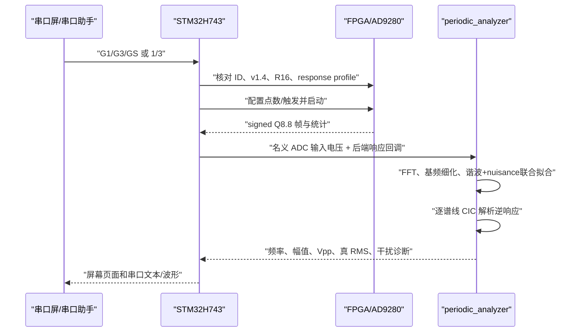

# 2026 年电赛 G 题设计报告模块

> 本模块可直接作为总设计报告中的“系统设计与实现”章节使用。参数以当前
> `AD9280 + Zynq7020 + STM32H743` 工程为准。当前信号在进入 AD9280 前没有
> 放大，经验校准表未启用；队伍名称、实测误差、模拟前端和实物照片应在完成
> 板级测试后补充，不能用理论值代替。

## 1. 设计目标与总体方案

系统完成 10 kHz～500 kHz 周期信号的基频识别、频谱分量测量、峰峰值和真有效值
计算，并在第三问中分离约 1 MHz 的干扰。为避免滤波器改变被测频带精度，系统不对
10～500 kHz 数据做低通、陷波或频谱删点；FPGA 固定抽取链的确定性幅相响应由
STM32 按解析式逐频恢复，1 MHz 干扰则作为联合拟合中的 nuisance 分量估计。

| 指标 | 当前设计值 |
|---|---:|
| AD9280 物理采样率 | 32 MSPS |
| FPGA 数字链路 | 固定 CIC3/R16，无旁路或可变抽取 |
| STM32 等效采样率 | 2 MSPS |
| 分析点数 | 4096 点 |
| FFT 频率间隔 | 488.28125 Hz |
| 被测频带 | 10 kHz～500 kHz |
| 联合拟合分量 | 最多 3 条被测谐波，另加不输出的 1 MHz nuisance |
| FPGA 缓存格式 | signed Q8.8，最多 4096 点 |
| 采集协议 | v1.4，`0x00010004` |
| 数字响应 profile | CIC3/R16，`0x00030010` |

采样率和 FFT 频率间隔为

$$
f_s=\frac{32\ \mathrm{MHz}}{16}=2\ \mathrm{MHz},\qquad
\Delta f=\frac{f_s}{4096}=488.28125\ \mathrm{Hz}.
$$



```mermaid
flowchart LR
    A["被测周期信号（当前无放大）"] --> B["AD9280 模块 S2"]
    B --> C["Zynq7020：32 MSPS"]
    C --> D["固定 CIC3/R16"]
    D --> E["signed Q8.8、2 MSPS、4096 点"]
    E --> F["STM32 SPI2 读取"]
    F --> G["FFT 候选与基频细化"]
    G --> H["被测谐波 + 1 MHz nuisance 联合拟合"]
    H --> I["逐谱线 CIC 解析幅相补偿"]
    I --> J["Vpp、真 RMS、频谱与完整周期波形"]
    J --> K["USART2 串口屏 + USART1 串口助手"]
```

## 2. 硬件系统

### 2.1 当前模拟输入边界

当前信号直接进入 AD9280 模块 S2，采集前没有 8 倍放大器，也没有已经确认安装并
标定的六阶低通。软件按 AD9280 模块名义量程换算 S2 输入端电压，不能替代示波器
实测。信号源、BX71、STM32、AD9280 模块和示波器必须共地，并固定 High-Z/50 Ω
端接条件后再比较幅值。

未来若增加模拟抗混叠前端，应实测其 10～500 kHz 通带平坦度、相位、噪声、
动态范围和 1 MHz 以上抑制度。模拟前端的真实响应不得混入 CIC 理论补偿；只有
硬件固定且误差具有重复性后，才可建立独立经验校准。

### 2.2 FPGA 固定采集链

生产顶层为 `g_analyzer_zynq_top`，主要由以下模块组成：

1. `ad9280_clkgen` 产生 32 MHz ADC 时钟；
2. `cic3_decimator_16` 完成固定三级 CIC、16 倍抽取、对称舍入和饱和；
3. `ad9280_capture_core` 完成触发、OTR/统计、4096 点 BRAM 和寄存器映射；
4. `stm32_spi_reg_slave` 实现 SPI mode 0、MSB first 的六字节寄存器帧。

FPGA 将 8 位 ADC 的偏移二进制转换为有符号数据，CIC 输出以 signed Q8.8 传输。
一个物理 ADC 码仍约为 `10 V/256=39.0625 mV`；一个传输 LSB 约为
`10 V/65536=0.152588 mV`。Q8.8 保留 16 次过采样形成的亚码平均信息，但不会
把 8 位 ADC 变成真实 16 位器件。

### 2.3 STM32 与 BX71 接线

| STM32H743 | BX71 P2 | 功能 |
|---|---:|---|
| PI1 / SPI2_SCK | P2-31 | SPI 时钟 |
| PB15 / SPI2_MOSI | P2-37 | 写寄存器/命令 |
| PI2 / SPI2_MISO | P2-33 | 读寄存器/采样数据 |
| PE8 / FPGA_CS | P2-34 | 低有效片选 |
| PH9 / FPGA_IRQ | P2-35 | 可选状态输入 |
| 任一 GND | P2-30 或 P2-12 | 共地 |

陶晶驰串口屏使用 USART2（PA2/PA3，115200-8-N-1）；串口助手使用 USART1
（PA9/PA10，115200-8-N-1）。两路交互共用同一套测量状态和算法。

## 3. FPGA 协议与响应声明

主要寄存器如下：

| 地址 | 名称 | v1.4 作用 |
|---:|---|---|
| `0x20` | CONTROL | 启动/终止采集 |
| `0x21` | STATUS | ADC 就绪、忙、完成和触发状态 |
| `0x22` | SAMPLE_COUNT | 目标保存点数，最大 4096 |
| `0x23` | DECIMATION | 只读兼容元数据，固定返回 `16`；写入忽略 |
| `0x24` | TRIGGER | 触发模式和阈值 |
| `0x25` | READ_ADDR | BRAM 读地址 |
| `0x26` | READ_DATA | 地址标签和 signed Q8.8 样本 |
| `0x27` | CAPTURED_COUNT | 实际保存点数 |
| `0x28` | OVERRANGE_COUNT | ADC 越界计数 |
| `0x29` | SAMPLE_CLK_HZ | 物理采样时钟，32 MHz |
| `0x2A` | DEVICE_ID | `0xAD928001` |
| `0x2B` | FIRMWARE_VERSION | `0x00010004` |
| `0x2C`～`0x2E` | 统计 | 最小/最大、累加和、最新样本 |
| `0x2F` | RESPONSE_PROFILE | 只读 `0x00030010`；写入忽略 |

STM32 初始化时同时核对设备 ID、v1.4 版本、固定 R16、signed Q8.8 格式和响应
profile。任何一项不匹配都停止测量并报告格式错误，避免旧位流被误当成当前链路。

## 4. STM32 测量算法

### 4.1 ADC 后端解耦

业务层只依赖 `BSP/signal_adc.h`。当前
`BSP/signal_adc_ad9280.c` 负责 AD9280 的码制、SPI 传输、采样率、名义电压
换算、削顶条件，以及固定 CIC 的数字幅相响应回调。以后切换 ACM9238/AD9238 时，
只替换 ADC/FPGA 后端并如实声明这些属性；`g_contest_app.c`、串口交互和
`periodic_analyzer.c` 不应依赖具体 ADC 型号。

### 4.2 名义电压换算

令 FPGA 返回的 signed Q8.8 整数为 $q$，当前 AD9280 后端使用

$$
V_{\mathrm{nominal}}=q\cdot\frac{10}{65536}\ \mathrm{V}.
$$

当前采集前增益按 1.0 处理，经验电压/频响校准表关闭。该公式表示模块名义输入
电压，不是整机两点实测校准，也不能修复端接误差、ADC 非线性或削顶。

为便于以后建立后端电压传递标定，USART1 的 `CAL/Q/EXIT` 模式可连续采集
16×4096 点 FPGA 原始 Q8.8 统计量。该路径不做伏特换算和频响补偿，也不会自动
保存或启用标定系数；只有在 S2 端同步测得两个稳定直流点后，才可计算并复核
$V=aQ+b$。

### 4.3 CIC 解析幅相补偿

固定 CIC 的通带有确定性下垂和线性相位。令级数 $M=3$、抽取倍数 $R=16$、
物理采样率 $F=32\ \mathrm{MHz}$，直流归一化响应为

$$
|H(f)|=
\left|\frac{\sin(\pi fR/F)}
{R\sin(\pi f/F)}\right|^3,
\qquad
\arg H(f)=-2\pi f\frac{M(R-1)}{2F}.
$$

分析器对每条被测谱线执行复响应逆补偿：

$$
X(f)=\frac{Y(f)}{H(f)}.
$$

因此固定 CIC 可以降低数据率而不把它的幅值下垂和相位延迟留在最终
10～500 kHz 测量值中。该解析补偿不包含模拟前端，不使用近似插值表；当前
`cal_count=0`，启动日志明确显示经验校准关闭。

### 4.4 频率、谐波和 1 MHz 联合模型

处理流程为：

1. 对 4096 点去直流并执行 FFT，在 10～500 kHz 搜索候选峰；
2. 用谱峰插值获得初值，再以联合拟合残差为目标多级细化基频；
3. 选择最多 3 条有效谐波，并用 double 精度联合最小二乘求幅值和相位；
4. 在第三问中搜索约 1 MHz 干扰，将其加入所有频率细化和最终拟合；
5. 只对被测分量施加 CIC 解析逆响应，再重建完整周期并计算结果。

联合模型可写为

$$
x[n]=b+
\sum_{k\in\mathcal K}
\left(a_k\sin\omega_kn+c_k\cos\omega_kn\right)
+u\sin\omega_In+v\cos\omega_In .
$$

最后两列是 1 MHz nuisance，仅用于解释干扰能量，不参与被测频谱、Vpp 或真 RMS。
当 2 MSPS 采样下干扰恰好位于 1 MHz 奈奎斯特点时，正弦/余弦中只有一个交替序列
投影可观测，算法只保留有能量的独立列，避免矩阵奇异；靠近或越过奈奎斯特时按
采样后的等效混叠频率联合拟合。`[REJECT]` 的 `post_dsp_peak/rms` 是 CIC 输出
采样域的诊断量，不做 CIC 逆响应或经验校准；尤其在精确奈奎斯特点，它只表示
实际被样本观测到的交替投影，不能推断采样点之间不可观测的源信号正交分量。

由校正后的被测系数得到

$$
A_k=\sqrt{a_k^2+c_k^2},\qquad
\phi_k=\operatorname{atan2}(c_k,a_k),\qquad
V_{\mathrm{RMS}}=
\sqrt{\sum_k\frac{A_k^2}{2}}.
$$

程序用同一组校正后的被测分量重建一个或三个完整周期，扫描重建波形得到 Vpp。
这种方法没有对 10～500 kHz 施加滤波；没有 1 MHz 干扰时，启用/关闭 nuisance
模型的结果在回归精度内保持一致。

### 4.5 无法由软件恢复的误差

ADC/运放削顶、ADC 非线性、时钟抖动、模拟噪声、端接错误，以及抽取前已经混叠到
同一离散频率的未知信号均不能靠逆响应恢复。`clip=1` 或 OTR 有效时必须先处理
硬件，不能用校准因子掩盖。

## 5. 软件流程与交互



启动日志应包含类似：

```text
[G] READY ADC=AD9280+FPGA-CIC3-R16-S16Q8.8 physicalFs=32000000Hz Fs=2000000Hz N=4096 df=488.28125Hz
[G] empirical_frequency_calibration=OFF analytic_response_compensation=ON voltage_transfer=nominal
[G] interference_rejection=joint_model expected=1000000Hz search=+/-5000Hz ...
[CLI] READY USART1 115200 8N1; send 1 or 3
```

串口助手输出 `[MEAS]`、`[REJECT]` 和 `[SPEC]`。`[WAVE] begin` 与
`[WAVE] end` 之间每行只输出一个 mV 电压值，便于直接复制绘图。

## 6. 验证与实物校准

已完成的数字验证包括：

- CIC signed Q8.8 舍入/饱和，以及 10、50、100、200、300、400、500 kHz
  解析幅相补偿行为仿真；
- 采集核 v1.4、固定 R16、`0x00030010`、触发、OTR、统计和读回回归；
- 主机矩阵中的频带边缘、强谐波、多谱线、CIC 补偿、无干扰开关不变性；
- 精确 1 MHz、奈奎斯特附近、越过奈奎斯特后的混叠干扰、多被测分量叠加和
  低于 1 mV RMS 门限用例。

正式提交前仍应使用信号源和示波器完成：

1. 10、50、100、200、300、400、500 kHz 单音扫频；
2. 题目规定的多档幅度及基波+二次/三次谐波组合；
3. S2 端真实 Vpp 与程序峰值、Vpp、RMS 的逐点对照；
4. 叠加 1 MHz 干扰，确认无削顶、被测结果误差和 `[REJECT]` 诊断；
5. 端接、线缆、温漂、重复性和单帧延迟记录；
6. 更换 ACM9238/AD9238 后重新执行整套后端与实物验证。

经验校准表在上述整机数据稳定前保持关闭。若以后启用，必须与 CIC 解析响应分层：
CIC 使用确定性公式，经验表只描述已固定硬件的剩余可重复误差。

## 7. 风险与对策

| 风险 | 对策 |
|---|---|
| FPGA 与 STM32 镜像不配套 | 同时核对 v1.4、固定 R16、signed Q8.8 和 `0x00030010` |
| 500 kHz 附近 CIC 下垂 | 使用后端解析复响应逐谱线补偿，不使用近似校准表代替 |
| 1 MHz 滤波伤及被测信号 | 不滤波；将干扰作为不输出的联合 nuisance 分量 |
| 输入/ADC 削顶 | 检查 OTR、最值和 `clip`，优先降低输入或修复硬件 |
| 模拟链路误差被误当作已校准 | 当前只报告 nominal ADC input voltage，实测后再建后端校准 |
| 更换 ADC 导致算法耦合 | 通过 `signal_adc.h` 替换后端并声明真实响应 |
| 带外混叠 | 未来增加并实测模拟抗混叠前端；软件不能恢复不可辨识混叠 |

## 8. 结论模板

本设计采用 AD9280、Zynq7020 和 STM32H743 构成分层式周期信号分析系统。FPGA
以 32 MSPS 采样并通过固定 CIC3/R16 生成 2 MSPS signed Q8.8 数据帧；STM32
利用 ADC 后端提供的精确数字响应逐谱线恢复 CIC 幅相，通过 FFT、基频细化和
双精度联合最小二乘得到最多三条被测谐波，并将约 1 MHz 干扰作为不参与结果的
nuisance 分量分离。陶晶驰串口屏为默认交互，USART1 串口助手同时可用。当前
经验校准关闭、采集前无放大，最终精度结论以 S2 端实测扫频、幅度、干扰和温漂
数据为准。
