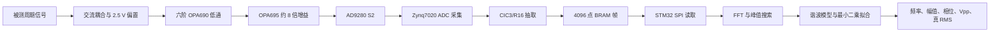
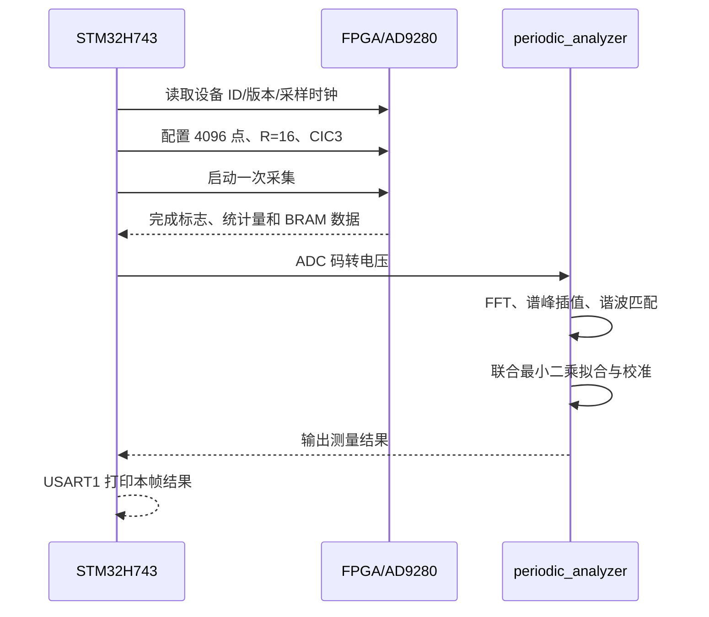

# 2026 年电赛 G 题设计报告模块

> 本模块可直接作为总设计报告中的“系统设计与实现”章节使用。文中参数以当前工程的远端 G 题方案为准：`AD9280 + Zynq7020 + STM32H743`。队伍名称、作者、实测误差和实物照片请在提交前补充。

## 1. 设计目标与总体方案

本系统面向 G 题周期信号的采集、频率识别、谐波分析和波形参数测量。系统采用“模拟前端抗干扰与调理—高速 ADC—FPGA 实时采集/抽取—STM32 数字分析”的分层结构，将高速、确定性强的采集任务放在 FPGA，将频率估计、谐波建模和结果输出放在 STM32H743。

系统主要指标如下：

| 指标 | 设计值 |
|---|---:|
| AD9280 物理采样率 | 32 MSPS |
| FPGA 抽取倍数 | CIC3，R=16 |
| STM32 等效采样率 | 2 MSPS |
| 分析点数 | 4096 点 |
| FFT 频率间隔 | 488.28125 Hz |
| 分析频带 | 10 kHz～500 kHz |
| 最多输出分量 | 基波及 2 条谐波，共 3 条 |
| 采集缓存 | FPGA BRAM，4096 点 |

采样率关系为

$$
f_s=\frac{32\ \mathrm{MHz}}{16}=2\ \mathrm{MHz},\qquad
\Delta f=\frac{f_s}{N}=\frac{2\ \mathrm{MHz}}{4096}=488.28125\ \mathrm{Hz}.
$$

系统工作链路如下：



## 2. 硬件系统设计

### 2.1 模拟前端

模拟前端只使用题目允许的单 +5 V 电源，输入端采用交流耦合，并通过分压产生约 2.5 V 的虚拟地 `VBIAS`。信号经三节 OPA690 Sallen-Key 低通后，再由 OPA695 提供约 8 倍电压增益，最后交流耦合至 AD9280 S2 模块。

- 三节 OPA690 组成六阶低通，目标截止频率约 650 kHz。
- 低通级按低 Q 到高 Q 的顺序串联，降低寄生振荡风险。
- OPA695 闭环增益理论值为 `1 + 348/49.9 = 7.974`，软件默认按 8 倍配置，最终以扫频实测值校准。
- 所有运放电源脚就近放置 100 nF 去耦，并在电源入口和 `VBIAS` 节点配置较大容量储能电容。
- `VBIAS` 作为交流参考点使用，滤波电容和反馈参考端不能误接真实 GND。

前端设计的核心取舍是先滤除高频干扰，再进行大增益放大。这样可以避免在单 +5 V 供电下，干扰信号先被大幅放大而导致运放或 ADC 削顶。

### 2.2 FPGA 采集与抽取

FPGA 顶层为 `g_analyzer_top`，主要逻辑由以下模块组成：

1. `ad9280_clkgen` 产生 AD9280 采样时钟；
2. `ad9280_capture_core` 完成触发、采样统计、BRAM 写入和 SPI 寄存器接口；
3. `cic3_decimator_16` 完成三级 CIC、16 倍抽取和偏移二进制恢复；
4. `stm32_spi_reg_slave` 将 STM32 SPI 帧转换为 FPGA 寄存器读写事务。

采集链在 ADC 时钟域完成原始数据锁存、越界统计和抽取，在配置时钟域通过双触发器同步状态量，避免跨时钟域直接使用异步信号。采集完成后，STM32 按样本地址读取 4096 个 8 位样本。

### 2.3 STM32 与 BX71 接线

| STM32H743 | BX71 P2 | 功能 |
|---|---:|---|
| PI1 / SPI2_SCK | P2-31 | SPI 时钟 |
| PB15 / SPI2_MOSI | P2-37 | 写寄存器/命令 |
| PI2 / SPI2_MISO | P2-33 | 读寄存器/采样数据 |
| PE8 / FPGA_CS | P2-34 | 低有效片选 |
| PH9 / FPGA_IRQ | P2-35 | 可选状态输入 |
| 任一 GND | P2-30 或 P2-12 | 共地 |

STM32 和 MSPM0G3507 不应同时驱动同一组 FPGA SPI 信号。FPGA IO 仅允许 3.3 V 电平，AD/DA 模块和 BX71 必须共地。

## 3. FPGA 寄存器与通信设计

G 题模式使用 SPI 访问 ADC 采集单元。主要寄存器如下，具体帧格式由 `fpga_link` 和 `ad9280.c` 统一封装：

| 地址 | 名称 | 作用 |
|---:|---|---|
| `0x20` | CONTROL | 启动/终止采集 |
| `0x21` | STATUS | ADC 就绪、忙、完成和触发状态 |
| `0x22` | SAMPLE_COUNT | 目标保存点数，最大 4096 |
| `0x23` | DECIMATION | 抽取倍数，G 题设置为 16 |
| `0x24` | TRIGGER | 触发模式和阈值 |
| `0x25` | READ_ADDR | BRAM 读地址 |
| `0x26` | READ_DATA | 当前样本数据 |
| `0x27` | CAPTURED_COUNT | 实际采集点数 |
| `0x28` | OVERRANGE_COUNT | ADC 越界采样计数 |
| `0x29` | SAMPLE_CLK_HZ | ADC 物理采样时钟 |
| `0x2A` | DEVICE_ID | 设备标识，期望为 `0xAD928001` |
| `0x2B` | FIRMWARE_VERSION | 采集协议版本 |
| `0x2C` | MIN_MAX | 本帧最小值和最大值 |
| `0x2D` | SUM | 本帧样本累加和 |
| `0x2F` | FILTER | bit0 开启 CIC3/R16 |

STM32 启动时依次完成设备 ID、固件版本、物理采样率和状态寄存器检查，再写入采样点数、抽取倍数和滤波器使能。任何校验失败都停止进入正常采集循环，并通过 USART1 输出诊断信息。

## 4. STM32 数字信号处理算法

### 4.1 电压标定

AD9280 为 8 位 ADC，软件使用两点标定将 ADC 码转换为 ADC 输入电压：

$$
V_{ADC}=V_L+\frac{C-C_L}{C_H-C_L}(V_H-V_L),
$$

其中 `C` 为 ADC 码，`(C_L,V_L)` 和 `(C_H,V_H)` 为现场测得的两点。再根据模拟前端增益换算到被测端：

$$
V_{IN}=\frac{V_{ADC}}{G_{FE}},\qquad G_{FE}\approx 8.
$$

当前代码中的 `0 -> -5 V`、`255 -> 4.9609375 V` 只是启动默认值，正式比赛前应使用实测数据替换。

### 4.2 频率与谐波估计

每次采集得到 4096 点电压序列，处理步骤如下：

1. 去除直流分量并执行 FFT；
2. 在 10 kHz～500 kHz 范围内搜索局部谱峰；
3. 对谱峰相邻三个频点进行抛物线插值，降低栅栏效应；
4. 以候选峰为基波，按整数倍频率匹配其他谱峰；
5. 对基波及最多两条谐波进行联合最小二乘正弦拟合；
6. 施加幅值/相位校准表，输出频率、峰值、相位、真 RMS、Vpp 和残差 RMS。

联合模型为

$$
x[n]=b+\sum_{k=1}^{K}\left(a_k\sin(k\omega_0 n)+c_k\cos(k\omega_0 n)\right),\quad K\le 3.
$$

由拟合系数得到第 `k` 条分量的峰值和相位：

$$
A_k=\sqrt{a_k^2+c_k^2},\qquad
\phi_k=\operatorname{atan2}(c_k,a_k).
$$

波形重建后扫描一个周期得到 `Vpp`，各正弦分量按均方根叠加得到真 RMS。频率响应补偿采用分段线性插值，既补偿模拟六阶低通，也补偿 FPGA CIC3/R16 的幅相变化。

### 4.3 削顶与异常判定

系统同时使用 ADC `OTR` 越界标志、样本最小/最大码和越界计数判定削顶。若发生削顶，结果中的 `clip` 位置 1，报告应优先提示降低输入幅度或检查模拟前端，而不能用软件补偿掩盖硬件饱和。

## 5. 软件结构与运行流程



对应代码入口为：

- `STM32H743/Core/Src/main.c`：G 题启动入口和主循环；
- `STM32H743/BSP/g_contest_app.c`：采集、标定、分析调度和结果输出；
- `STM32H743/Modules/ad9280.c/.h`：FPGA SPI 寄存器和样本读取；
- `STM32H743/DSP/periodic_analyzer.c/.h`：FFT、峰值搜索、谐波建模和参数计算；
- `FPGA_BX71_AD9708_AD9280/rtl/`：ADC 采集、CIC 抽取和 SPI 从机逻辑。

正常启动后，USART1 应输出类似：

```text
[G] READY AD9280=32MSPS CIC3/R16 Fs=2000000 N=4096 df=488.28125Hz
[G] #1 ... f0=...Hz vpp=...mV rms=...mV lines=... clip=0
```

## 6. 测试与校准方案

### 6.1 已完成的数字验证

- CIC3/R16 直流和时序仿真已纳入 FPGA G 题工程；
- AD9280 采集核心覆盖触发、抽取、统计、读回和中止后重新采集流程；
- `periodic_analyzer` 已纳入 STM32H743 Keil 工程并通过全量编译；
- 当前工程重新编译结果为 `0 Error(s), 0 Warning(s)`。

### 6.2 必须补充的实物验证

正式提交前应使用示波器和信号源完成以下闭环：

1. 10、50、100、200、300、400、500 kHz 单频扫频；
2. 50～250 mVpp 多档输入幅度测试；
3. 基波叠加二次、三次谐波测试；
4. 叠加 1 MHz、1.2 MHz、1.5 MHz 和 2 MHz 干扰，检查 `clip` 和频率稳定性；
5. 更新 `GContest_LoadInitialCalibration()` 中的幅相校准表；
6. 记录频率误差、Vpp 误差、真 RMS 误差、相位误差和单帧延迟。

建议用下表形成最终报告数据：

| 测试频率 | 输入幅度 | 干扰条件 | 测得频率 | Vpp 误差 | RMS 误差 | 延迟 | 结论 |
|---:|---:|---|---:|---:|---:|---:|---|
| 10 kHz |  | 无 |  |  |  |  |  |
| 100 kHz |  | 无 |  |  |  |  |  |
| 500 kHz |  | 无 |  |  |  |  |  |
| 100 kHz |  | 1 MHz 干扰 |  |  |  |  |  |

## 7. 方案特点与风险控制

### 7.1 方案特点

- FPGA 先抽取再传输，显著降低 STM32 的数据搬运压力；
- CIC3/R16 与 4096 点 FFT 参数固定，频率分辨率可计算、可复现；
- 频率搜索与谐波模型结合，对非纯正弦周期信号更稳定；
- 幅相校准表可通过扫频更新，不需要修改核心算法；
- ADC 越界、最小值、最大值和采样统计量同时上报，便于定位硬件问题。

### 7.2 风险与对策

| 风险 | 对策 |
|---|---|
| 前端增益过大导致削顶 | 降低 OPA695 增益或输入幅度，确认 `clip=0` |
| 500 kHz 附近幅相误差增大 | 使用扫频结果更新校准表，重点校准高频端 |
| FPGA 与 STM32 SPI 无响应 | 检查共地、PE8 片选、3.3 V 电平和 FPGA 位流版本 |
| 高频干扰串入前端 | 缩短去耦回路、保证 VBIAS 低阻抗、按信号方向布局 |
| 只验证仿真未验证实物 | 将扫频、干扰抑制和误差记录作为最终验收项 |

## 8. 结论模板

本设计采用 AD9280、Zynq7020 和 STM32H743 构成分层式周期信号分析系统。模拟前端完成偏置、六阶低通和增益调理；FPGA 以 32 MSPS 采样并通过 CIC3/R16 输出 2 MSPS、4096 点数据帧；STM32 使用 FFT、谱峰插值、谐波匹配和联合最小二乘拟合完成频率、幅值、相位、Vpp 和真 RMS 测量。数字链路和嵌入式工程已完成验证，最终精度结论以现场扫频、幅度标定及抗干扰实测数据为准。
